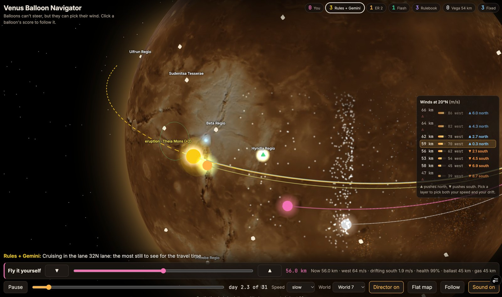

# Venus Balloon Navigator — Hack Plan

Built at [Sundai Club](https://www.sundai.club) · [Hack 144 — Autonomous Spacecraft Hack](https://www.sundai.club/events/boston/hack-144-autonomous-spacecraft-hack) · Sun Oct 11, 2026 · MIT

Created 2026-10-07 · Last edited 2026-10-11

**AI pilots, a simple rulebook and you race balloons around Venus, steering only by choosing which altitude's wind to ride.**

Live demo: https://venus-balloon-navigator.vercel.app



## About

**What it is.** A balloon on Venus can't steer, but the wind changes with height: higher layers blow west faster and push toward the poles; lower layers are slower and push toward the equator. So picking an altitude picks your speed and your north-south drift. This project turns that into a race between AI pilots, simple rules, balloons that never change height, and a human player.

**The simulator (`sim/`, Python).**
- **Winds** cover 44–68 km in 15-minute steps. They're made up, but shaped to match probe measurements: slow below 50 km, 60–100 m/s in the safe 50–62 km band, and a fast cloud-top jet near 66 km. Each world has its own launch point and weather, including the height where the north-south push flips. The pilots only know a forecast.
- **Risk:** outside 50–62 km, acid above and heat below wear out the envelope, and each hour there carries a chance of losing the balloon. Every balloon gets 45 km of climbing (ballast) and 45 km of sinking (gas) for the whole flight.
- **Things to collect:** 60 real named sites (USGS/IAU gazetteer); eruptions, gas plumes and lightning at 70 real volcanoes, with eruptions coming in spells; four mission-control messages per world (gas plumes worth triple, a bonus site, a relay outage, a volcano alert); and cloud-top and deep-air samples that only count inside the risky layers.
- **Scoring** ends at day 30, so surviving past it is worth nothing.

**The pilots.**
- **Fixed balloons** park at one altitude, including 54 km, as the Vega balloons did in 1985.
- **The rulebook** holds the busiest latitude lane until it runs out of sites, then roams, and sprints through the risky layers in its last 6 days.
- **Gemini Robotics-ER 2 and Gemini 3.8 Flash** look at a map image every 2 days (and whenever a message arrives), pick a lane, roam, sprint, or a place to head for, and explain why in one sentence.
- **The hybrid** lets the rulebook fly and only asks Gemini when a message, an open request, or a burst of eruptions comes up.
- **Shared autopilot code** flies between decisions for every pilot: a search planner that weighs risk against the days left, and a lane holder that learns the real winds.

**The website (`web/`, three.js).** A full-screen 3D Venus, with height exaggerated about 30×, shows glowing wind particles tinted by their north or south push, tethered balloons with trails, eruption pulses with halos that shrink as each one's time runs out, a 24-hour forecast for the selected balloon, and captured science lighting up on the surface. A wind panel lists each layer's speed and push, and a "director" camera frames each eruption catch in slow motion. You can fly your own balloon live, with the same physics and rules, against the AIs' saved flights. The site replays saved runs, so it can't crash on stage.

**Results** (20 worlds × 30 days, with risky layers, the gas and ballast budget, and mission-control messages): Gemini Robotics-ER 2 427, hybrid 421, rulebook 402, Gemini 3.8 Flash 363, best fixed altitude 316. Once risk enters, judgment pays: ER 2 sprinted through the risky layers at about half its check-ins and lost 1 balloon in 20; the rulebook sprints blindly in its last 6 days and lost 5. Before the risky layers, the rulebook won (393 vs 387 hybrid, 274 Flash, 271 ER 2). See "Current state" below for details.

**Code map:** `sim/venus.py` winds, physics and risk · `sim/planner.py` the search planner · `sim/mission.py` the mission loop and lane holder · `sim/strategist.py`, `sim/commander.py` the rulebook, Gemini and hybrid decisions · `sim/events.py`, `sim/missionctl.py` eruptions, messages and samples · `sim/export_web.py` builds the website's data · `web/app.js` the browser simulator and page · `web/globe.js` the 3D scene.

## Pitch

Balloons can't steer, but they can choose their wind. Our agent flies a balloon through the clouds of Venus by changing altitude, reaching science targets that no lander can survive long enough to visit.

Why it matters: Venus's surface is 460 °C and 90 atmospheres, so landers die in hours. But 50–60 km up, in the cloud deck, pressure and temperature are close to Earth's, and the whole atmosphere "superrotates": it circles the planet every 4 Earth days, far faster than the planet spins. Balloons are the one flight-proven way to live there: the Soviet-French Vega 1 and Vega 2 balloons flew at 54 km for about two days each in 1985 and covered roughly 11,000 km. They just couldn't choose where they went. Wind speed on Venus climbs steeply with altitude, and the north-south drift flips sign between the cloud top and the cloud base, so a balloon that picks its altitude picks its speed and its latitude. Google's Loon proved this kind of altitude steering on Earth with reinforcement learning; we port the idea to Venus and put an embodied-reasoning model in command.

Win condition for the demo: the agent reaches more targets in the same number of Earth days than a balloon that rides one altitude around the planet.

## Current state (Oct 11, 17:12)

Live demo: https://venus-balloon-navigator.vercel.app

Team: one human (Q) and Claude Code.

| Piece | State | Where |
|---|---|---|
| Targets | 60 real named science sites and 70 real named volcanoes from the USGS/IAU gazetteer (largest first, plus the original picks) | `sim/build_targets.py`, `sim/data/venus_features.json` |
| Worlds | Each world has its own launch point (30°S to 30°N) and weather: the height where north-south drift flips (52 to 60 km), wind speed, push strength, tide timing. The agents only know the forecast | `sim/venus.py` |
| Two AI balloons | Gemini Robotics-ER 2 and Gemini 3.8 Flash fly the same worlds with the same map image, prompt and tools. Every 2 days each picks a latitude lane or "roam"; between check-ins a planner flies | `sim/strategist.py`, `sim/commander.py` |
| Lanes | Worked out from where volcanoes and sites cluster (6 lanes, e.g. 11°N with 10 volcanoes) | `sim/strategist.py` |
| Roam | The planner chases the nearest unvisited sites at full speed | `sim/planner.py` |
| Science sensor events | Eruptions, gas plumes and lightning; the balloon only hears nearby ones | `sim/events.py` |
| Fly it yourself | On the website you fly a pink balloon live with a slider or arrow keys, against both AIs and the rulebook (purple). Small volcano sounds (made in the browser) play as eruptions and plumes start; there's a Sound on/off button. The clock stops at day 31; scores count to day 30. Hover any score card for how that balloon decides. The altitude strip marks every score with a dot and a tick in that balloon's row. No time limit: the AI flights end at day 30, yours keeps going and new events keep appearing | `web/app.js` |
| Website | 3D globe with star field and flat map; replays saved runs, so it can't crash on stage. Rebuild: `sim/export_web.py fly --model er|flash --seeds N` per world (in parallel), then `sim/export_web.py assemble`, then push to `main` | `web/` |

**What we learned:**
- Winds only blow west, so a balloon can't stay near a place; it can only pick a latitude and pass everything in it once a lap.
- With a few volcanoes, holding the busiest lane won. With 60 one-time sites, lanes run dry after a lap or two, and flying high and fast while sweeping across latitudes wins. Both models chose "roam" about 70% of the time.
- Varying launch points and weather removed the "58 km" luck: a fixed altitude only wins if you happen to pick the right one before launch.

**Harder worlds (added 15:20)**, built to separate the models from the rulebook:
- **Mission control messages**, four per world in plain text: gas plumes worth 3× for 8 days; a priority site worth +10 within 7 days; a relay outage that zeroes captures in one hemisphere for 6 days; a seismic alert that a volcano will erupt (and a 5-point major eruption really happens). Scoring applies to every balloon; only the models can read them, and they can name a place to "head for".
- **Volcanoes erupt in spells:** an eruption makes that volcano far likelier to erupt again over the next few days. The sensor log shows it; the rulebook ignores history.
- **No crutches for the models:** the prompt no longer lists unvisited sites per lane; the models read them off the map image.

**Latest round (17:12): risky layers switched on.** Winds now cover 44–68 km. Outside the safe 50–62 km band the envelope wears fast (acid above, heat below) and each hour carries a chance of losing the balloon. 8 cloud-top samples (above 63 km) and 8 deep-air samples (below 48 km) per world score 3 points each. Every strategist can "sprint" into the risky layers; the planner weighs each risky move against the points the balloon could still earn before day 30, so risk is cheap near the end. The rulebook sprints in its last 6 days (best of never / 3 / 6 / all 30 days in testing: 394 / 397 / 402 / 386).

**Scoreboard, 20 worlds, 30 Earth days each:**

| Balloon | Points | Sites | Layer samples | Bonus sites | Alert eruptions | Balloons lost |
|---|---|---|---|---|---|---|
| Gemini Robotics-ER 2 | 427 | 185 | 8 | 8 | 3 | 1 |
| Rulebook + Gemini ER 2 (hybrid) | 421 | 213 | 9 | 9 | 1 | 1 |
| Rulebook | 402 | 242 | 7 | 9 | 2 | 5 |
| Gemini 3.8 Flash | 363 | 172 | 8 | 7 | 2 | 1 |
| Best single fixed altitude (59.5 km) | 316 | 207 | 0 | 4 | 0 | 0 |
| Fixed at 54 km, like Vega 1985 | 215 | 151 | 0 | 2 | 0 | 0 |

What it says: for the first time a model beats the rulebook. ER 2 chose to sprint at about half its check-ins but did it with care, losing 1 balloon; the rulebook's fixed "sprint in the last 6 days" rule lost 5 balloons and with them their remaining points. The rulebook still sweeps the most sites.

Previous round (budget, no risky layers): rulebook 393, hybrid 387, best fixed 316, Flash 274, ER 2 271. Earlier rounds: fair requests 6° away: rulebook 456, ER 2 388, Flash 376. Unreachable requests: rulebook 349, ER 2 319, Flash 306. Easier worlds: rulebook 363, Flash 303, ER 2 300.

**Visualization (16:25):** the globe fills the screen. A cloud shell has a wedge cut away at the selected balloon to show the wind layers: amber particles flowing west at each layer's speed and bending north or south, brightest at the selected balloon's layer. Altitude is exaggerated about 30× and each balloon has a tether to the ground. Eruptions send a crimson pulse into the clouds and get a halo that shrinks as the window closes. The selected balloon shows a dashed 24-hour forecast at its current height and a capture disc. Captures light points on the surface, which stay lit when the winds dim at the finish. The "director" pauses before the selected AI balloon catches an eruption, frames the shot, and plays it slowly; the trail flashes on capture. Click a score chip to select a balloon.

## The simple version

**The simulator** is a pretend Venus with a balloon on it. The wind on Venus is like a giant conveyor belt that always pushes the balloon west. The balloon can't steer. It can only go up or down. Higher up, the belt runs faster. Lower down, it runs slower. The wind also nudges the balloon a little north or south, and up high it pushes the opposite way from down low.

The balloon has to stay in a safe zone. Too low and it's too hot. Too high and the clouds eat it. Every 15 pretend minutes, the balloon picks one of three moves: go up, stay, or go down. Then the wind carries it. If it floats close to a target, like a volcano, it gets a point.

**The planner** is the balloon's brain. Every 6 pretend hours, it imagines a few hundred "what if" trips five days ahead. One trip goes high, then low. Another stays low the whole way. It flies all of them in its head at once and keeps the ones that got closest to targets. Then it imagines more trips like the winners, three times over. It takes the first step of the best trip and starts over 6 hours later.

**The drifter** is the dumb balloon. It picks one height and never changes. That's what the real Vega balloons did in 1985.

**As of Oct 11 at noon**, the planner beats the best drifter from 1 of 5 launch points and ties at the other 4. It's smarter, but not much smarter yet. Code: `sim/venus.py` (simulator), `sim/planner.py` (planner), `sim/compare.py` (scoreboard).

## How the simulation works

A 2D map plus an altitude dimension, stepped every 15 simulated minutes (at 100 m/s that is about 90 km per step, so one lap of the planet is roughly 400 steps).

| Element | What it holds |
|---|---|
| State | Latitude, longitude, altitude, Earth-hours elapsed, local solar time, buoyancy budget |
| Actions | Ascend, hold, or descend, one choice per step |
| Wind field | u, v wind by altitude band, latitude, and local time, interpolated from a small table |
| Targets | 4–6 named science sites, each with a capture radius |
| Score | Targets reached, laps flown, Earth days elapsed |

The constraint that makes it interesting: the balloon lives in a narrow corridor, about 50–62 km. Below it the air is too hot for the envelope; above it the sulfuric-acid cloud top and thinning air end the ride. Inside the corridor, altitude is a speed dial: roughly 60 m/s near the bottom and 100 m/s near the top, always westward. You can never fly backward. Every target comes around again on the next lap, so the game is phasing: pick the altitude that puts you at the target's longitude when your slow north-south drift has brought you to its latitude. An audience understands "conveyor belt plus a speed dial" immediately.

Keep the physics simple: altitude changes at a fixed rate per step, and horizontal motion equals the wind at the current altitude. Nobody will judge buoyancy equations; they will judge whether the agent makes smart choices.

### How the balloon moves north and south

The balloon can't steer north or south directly. It can only change altitude, and the north-south wind blows in opposite directions above and below the middle of the corridor (about 56 km). So picking an altitude picks the direction of drift.

- **Above about 56 km**, the wind pushes the balloon toward the nearer pole.
- **Below about 56 km**, it pushes the balloon toward the equator.
- **Near 56 km**, the north-south push mostly cancels out.

This is a simplified version of Venus's real circulation (a "Hadley cell"). The push is strongest around 45° latitude and fades to nothing at the equator and the poles. It is slow: about 5° of latitude per Earth day at most, against the 60–100 m/s westward wind. A second, smaller wind flips direction with the time of day. That lets a balloon cross the equator if it times its altitude to the local time.

Two parts of the agent use this differently. When cruising, the agent holds its chosen lane with a simple rule: go high to drift poleward, go low to drift toward the equator, sit near 56 km once it's there. When chasing an event, the planner has no such rule. It tries hundreds of altitude schedules, flies each one through the same wind model, and keeps the ones that reach the target soonest; heading north or south falls out of that search. Altitude also sets east-west speed, so a chase has to match the target's latitude and longitude at the same moment. This also explains the scoreboard: a balloon parked at 58 km drifts slowly poleward from the launch point into the 22°N lane, where three volcanoes sit, so it scores about as well as the agent without trying.

These winds are made up to match the plan, not taken from real Venus data. The 56 km turning point and the strength of the push are tuning choices in `sim/venus.py`.

## Sensors

Two ways to add sensors. The science sensors are planned for today. Navigation without GPS is a stretch goal.

### Science sensors (today, about an hour)

The real Vega balloons measured temperature, pressure, light, and cloud particles. Newer Venus balloon ideas add a gas sniffer (for example, sulfur dioxide) and a microphone for very low sounds, which could pick up venusquakes or eruptions.

In the sim, a sudden reading creates a new target partway through the flight: "sulfur dioxide spike 300 km south", or "low rumble, maybe Maat Mons". The commander decides whether to chase it or stick with the plan, and explains why in the log. This uses the surprise target already in the plan.

Build: a small event generator in the sim, one new tool (`report_event`) shown to the commander, and markers on the map that pop up and then fade.

### Navigation without GPS (stretch)

Venus has no GPS, and the balloon flies inside the clouds, so it can't see the stars. It has to estimate where it is. Ways to do that, from cheapest to fanciest:

| Method | What it tells you | Catch |
|---|---|---|
| Pressure sensor | Altitude, very accurately | Altitude only |
| Light sensor | Local time of day, so roughly how far east or west you are of the noon point | Rough, and useless at night |
| Counting from the last fix (speed × time) | A best guess that keeps going | The guess drifts more every hour |
| Radio tracking from Earth or an orbiter | A good position (this is how Vega was tracked) | Worked out far away and arrives late |
| Infrared camera at night | Blurry shapes of the ground, matched against the Magellan map | Needs a smart image reader, which is the Gemini Robotics-ER job |
| Downward radar | The height of the ground below, matched against Magellan elevation | Extra hardware and weight |

**How do we know we reached a target?** The balloon never knows for certain. It carries a best guess plus a circle of doubt that grows between fixes. It *claims* a target when its whole circle of doubt fits inside the target's capture radius. Later, radio tracking from Earth confirms or denies the claim. For science targets, the instruments can also confirm it: the infrared camera sees the volcano, or the gas sniffer smells the plume.

In the sim, the true position stays hidden from the agent. The agent sees only its guess. The map shows the doubt circle shrinking each time a fix arrives. The scoreboard counts a target only if the true position was inside the radius, and counts wrong claims against the agent. This tests whether the commander knows when to spend time on a fix, for example waiting for night to take an infrared picture, before claiming a target.

## Controllers

The commander decides where to go; a search-based planner decides how. Keeping the model out of the step-by-step control is deliberate: it is slow and imprecise at that, but good at weighing goals, reading a map, and explaining choices.

**Commander: Gemini Robotics-ER 2** (`gemini-robotics-er-2-preview`, Google's embodied-reasoning model, public preview since July 2026). It is built for exactly this split: spatial reasoning over images, breaking a task into sub-tasks, and multi-step tool use with function calling. We hand it the rendered map (tracks, targets, the safe corridor) as an image plus a short state summary, and expose two tools: `set_target(site)` and `set_altitude_band(km_low, km_high)`. Run it at `thinking_level: "medium"`. Its streaming sibling (`gemini-robotics-er-2-streaming-preview`, Live API) is the bonus path for a live-narrated run.

```
┌─────────────────────┐     target + corridor      ┌─────────────────────┐
│  Commander          │ ─────────────────────────▶ │  Search planner     │
│  Gemini Robotics-ER │                            │  ascend / hold /    │
│  reads the map,     │ ◀───────────────────────── │  descend per step   │
│  picks the target,  │   position, time, targets  └──────────┬──────────┘
│  writes the log     │                                       │ action
└─────────────────────┘                                       ▼
┌─────────────────────┐                            ┌─────────────────────┐
│  Drifter baseline   │ ──── same sim, fixed ────▶ │  Simulator          │
│  (fixed altitude,   │        altitude            │  winds, corridor,   │
│   like Vega 1985)   │                            │  scoring            │
└─────────────────────┘                            └─────────────────────┘
```

The drifter flies the same sim at a fixed altitude, so the comparison is fair, and it is historically honest: that is what Vega did. Stretch goal: swap the planner for an RL policy and close with "Loon did this on Earth, Vega flew Venus blind in 1985; here is Venus with eyes."

## Shortcuts and data sources

- **Simulator:** our own plain 2D numpy sim in `sim/venus.py`. We tried Google's open-source Balloon Learning Environment first and dropped it: it installs, but it is built around one spot on Earth, Earth air pressure, and a score for staying near home.
- **Winds:** the Venus Climate Database (the LMD group's Venus counterpart of the Mars Climate Database, current release v2.3) gives wind profiles by altitude, latitude, and local time. Not pulled yet; a small table would be a few latitudes × 8 altitude bands × 12 local times. In use now: synthetic winds with zonal speed rising from 60 to 100 m/s across the corridor, a few m/s poleward at the cloud top, equatorward near the base. Sanity-check against the published Vega balloon tracks.
- **Map:** a Magellan radar mosaic as the background.
- **Targets:** real sites so the story lands: Maxwell Montes (the highest peak), Maat Mons (the volcano that was caught changing shape in Magellan data), Alpha Regio (where NASA's DAVINCI probe is headed), Ovda Regio in Aphrodite Terra, plus one "surprise" target (for example a fresh sulfur-dioxide plume) that the commander can choose to chase.
- **Commander:** Gemini API key from Google AI Studio; confirm `gemini-robotics-er-2-preview` answers a tool call before Sunday. Keep the same tool schema so the planner never cares which model is behind it.
- **Deployment:** the live site replays precomputed runs as JSON, so the demo cannot crash. Run the agent live only as a bonus.

## Demo design

One web page that tells the story in 3 minutes:

- **Map:** the Magellan basemap with the drifter's track in grey and the agent's track in color, animated side by side as both lap the planet.
- **Targets:** markers that turn green when reached.
- **Corridor strip:** a small chart of altitude over time with the 50–62 km safe band shaded, so viewers see the agent switching wind layers and staying alive.
- **Commander log:** a sidebar where the model's decisions appear as they happen ("Maat Mons is 40° ahead and 10° south; dropping to 52 km to slow down and let the equatorward drift bring me onto it").
- **Closing numbers:** targets reached and laps flown, agent vs. drifter, in the same Earth days.

Pitch arc: the problem (Venus kills landers, the clouds are the only place to live), the precedent (Vega flew there in 1985 but blind), the trick (altitude steering), the replay, the numbers, then one line on what this would mean for a real mission.

## Team and timeline

Planned for 3–4 people. Actual team: Q plus Claude Code, so one person covers every role below.

| Role | Owns | Done when |
|---|---|---|
| Sim and winds | Environment, wind table, corridor, scoring | The drifter laps the planet end to end and outputs a track |
| Planner | Search controller, phasing logic | The planner beats the drifter on targets reached |
| Commander | Gemini Robotics-ER tools, prompt, mission log | The commander picks targets from the map image and writes a readable log |
| Frontend | Map, replay, deployment | A public URL replays both runs |

Sunday schedule (hack time runs 12:00–20:00; the [event page](https://www.sundai.club/events/boston/hack-144-autonomous-spacecraft-hack) has the full day, starting 10:00):

1. **12:00–14:00:** pitch, form the team, get the drifter flying and one track drawn on the map.
2. **14:00 check-in:** show the end-to-end loop, even if ugly.
3. **14:00–17:00:** the planner beats the drifter; the commander is connected and calling tools.
4. **17:00–19:00:** add the corridor constraint, polish the replay, save backup runs.
5. **19:00–20:00:** deploy, rehearse the 3-minute pitch twice.

If the 16:00 run/bike tempts you, take it only if the planner already works.

## Prep, risks, and questions

**Before Sunday**

- [x] Export the Venus wind table from the Venus Climate Database (or write the synthetic fallback). Synthetic fallback done in `sim/venus.py`; the real Venus Climate Database table is still open
- [x] Clone the Balloon Learning Environment and confirm it installs. It installs (Python 3.10, `numpy<2`, `scipy<1.14`, plus `tensorboard`), but it assumes Earth: flat x/y around one home spot, altitude from Earth air pressure, and a score for staying near that spot. Decision: skip it and use the numpy sim in `sim/venus.py`
- [x] Download a Magellan basemap image and pick the 4–6 target sites. Map in `assets/` (USGS, public domain); 6 targets in `sim/venus.py`
- [x] Get a Gemini API key and confirm Gemini Robotics-ER 2 returns a tool call (confirmed via the API on Oct 11: `set_target` called correctly, about 1 s per reply)
- [x] Write the noon pitch: two sentences and one sketch of the map. Sketch at `docs/pitch_sketch.png`, drawn from a real sim run (`uv run --with numpy --with matplotlib python sim/sketch.py`)
- [x] Set up a repo and a static hosting target

**Risks and fallbacks**

| Risk | Fallback |
|---|---|
| Balloon Learning Environment takes too long to adapt | Happened. Using the plain 2D numpy sim |
| No usable Venus wind data | In use: synthetic layered winds tuned to the Vega profile |
| Planner doesn't beat the drifter | Half happened: beats Vega's 54 km, not the best fixed altitude. Next: tune targets or the planner's early choices |
| Gemini Robotics-ER 2 preview is rate-limited or flaky live | Same tool schema on a general Gemini model; replay logged decisions from precomputed runs |

**Questions for Alejandro Carrasco Aragón** (guest speaker, MIT AeroAstro; talk at 11:00)

- In your KSP agent work, did LLMs do better at long-horizon planning or at reactive control? (This justifies our commander-plus-planner split.)
- Does an embodied-reasoning model like Gemini Robotics-ER actually read a map better than a general model, or is the gain all in the tool-use loop?
- What would a real Venus balloon mission need from onboard autonomy that our demo ignores?
